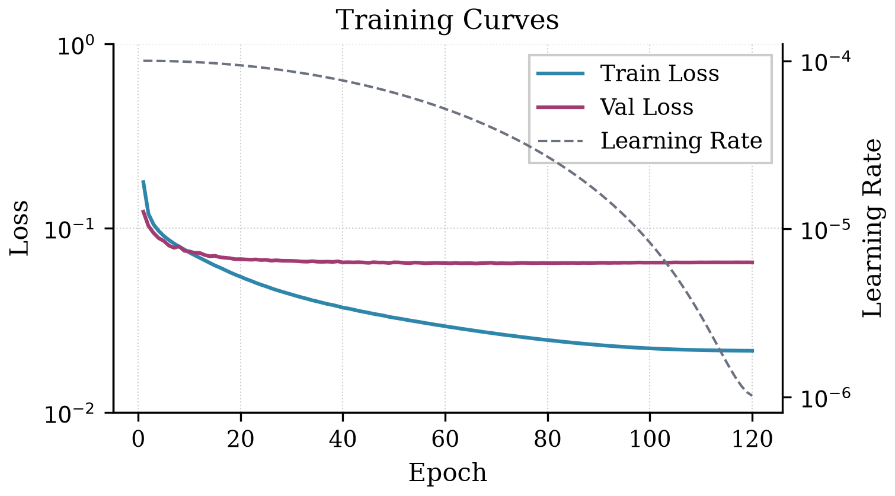

# OpenFWI Style-A: 2D Velocity-Map Regression

This example trains a U-Net to predict a 70 × 70 subsurface velocity map from
five seismic shot gathers. Each input has shape `(5, 1000, 70)` (shot, time,
receiver); each target has shape `(1, 70, 70)` in m/s, with velocities in
`[1500, 4500]`.

`unet_fwi.py` builds on WaveDL's `unet_field`. It pads time from 1000 to 1120
and compresses it with four stride-`(2, 1)` convolution blocks
(`1120 / 2⁴ = 70`), so the depth-4, base-64 U-Net runs directly on the 70 × 70
output grid. The model has 31.29 million parameters and is loaded with
`--import`.

## 1. Download the Data and Build Manifests

Download **Style-A** from the [OpenFWI dataset page](https://openfwi-lanl.github.io/).
Extract it so the `Style_A` directory contains `data/data1.npy` through
`data/data134.npy` and `model/model1.npy` through `model/model134.npy`.

From the WaveDL repository root, with WaveDL installed from this checkout:

```bash
STYLE_A=/path/to/Style_A
MANIFESTS="$HOME/openfwi-style-a-manifests"
RUN="$HOME/openfwi-style-a-unet"

python3 examples/openfwi_style_a/make_manifests.py "$STYLE_A" --output-dir "$MANIFESTS"
```

The manifests list tab-separated input and target paths, relative to the
manifest directory. WaveDL reads the `.npy` shards lazily; no conversion or
concatenation is needed.

| Manifest | Shard pairs | Samples |
|----------|-------------|--------:|
| Training | 1–120 | 60,000 |
| Validation (monitoring only) | 109–120 | 6,000 |
| Test | 121–134 | 7,000 |

> [!IMPORTANT]
> The model trains on OpenFWI's full official training split for a fixed
> 120 epochs, and the **final-epoch weights** are evaluated. The validation
> manifest repeats the last 12 training shards, so its metrics only track the
> fit; nothing in the schedule depends on them. Do not report `best_checkpoint`,
> and never pass the test manifest as `--val_data_path`.

## 2. Train the U-Net

```bash
wavedl-train --num_gpus 1 --import examples/openfwi_style_a/unet_fwi.py --model unet_fwi \
  --data_path "$MANIFESTS/style-a_train.txt" --val_data_path "$MANIFESTS/style-a_val.txt" \
  --input_channels 5 --input_transform signed_log_minmax --input_range -24.96 48.93 \
  --target_scaling minmax --target_range 1500 4500 \
  --precision no --no_tf32 --batch_size 64 --epochs 120 --patience 200 \
  --loss mae --optimizer adamw --betas 0.9,0.999 --weight_decay 1e-4 --grad_clip 0 \
  --lr 1e-4 --scheduler cosine --min_lr 1e-6 --workers 16 --save_every 5 \
  --output_dir "$RUN"
```

Training uses float32 with TF32 disabled, L1 loss on targets scaled to `[-1, 1]`,
and AdamW with a cosine learning-rate decay. `--save_every 5` writes the
final weights to `epoch_120_checkpoint`. The paper's run took **2.64 hours on
one RTX PRO 6000**; runtime depends on hardware and storage throughput.

## 3. Evaluate the Held-Out Test Set

```bash
wavedl-test --import examples/openfwi_style_a/unet_fwi.py \
  --checkpoint "$RUN/epoch_120_checkpoint" --data_path "$MANIFESTS/style-a_test.txt" \
  --batch_size 32 --workers 8 --no_tf32 --save_predictions --output_dir "$RUN/test"

python3 examples/openfwi_style_a/score_openfwi.py "$RUN/test/predictions.npz" \
  --output "$RUN/test/openfwi_scores.json"
```

`wavedl-test` restores preprocessing from the checkpoint and saves the targets
and predictions in physical units. `score_openfwi.py` reports MAE and RMSE both
in m/s and on OpenFWI's `[-1, 1]` scale (divide the physical errors by 1500),
alongside pixel-pooled $R^2$, Pearson $r$, and SSIM on maps rescaled to `[0, 1]`
without clipping, using the
[OpenFWI reference](https://github.com/lanl/OpenFWI/blob/main/pytorch_ssim.py):
an 11 × 11 Gaussian window with σ = 1.5. Every test sample has equal weight,
including samples in a partial final batch.

The paper's run scored MAE 0.0653, RMSE 0.1072, and SSIM 0.8761 on the 7,000 test
maps (97.96 m/s MAE). GPU nondeterminism makes a rerun differ slightly.

## 4. Plot a Test Sample

```bash
python3 examples/openfwi_style_a/plot_sample.py "$RUN/test/predictions.npz" \
  "$MANIFESTS/style-a_test.txt" --sample 0 --output "$RUN/test/sample_0"
```

`--sample` is a zero-based index in test manifest order. The PNG and PDF show
shots S1, S3, and S5 (with a display-only time gain), ground truth, the U-Net
prediction, and signed error (prediction minus ground truth) with sample MAE.

## Included Files and Reference Results

| File | Description |
|------|-------------|
| `unet_fwi.py` | U-Net model built on WaveDL's `unet_field` with a 4-stage time-compressing stem |
| `make_manifests.py` | Builds train, validation, and test `.txt` shard manifests from `Style_A/` |
| `score_openfwi.py` | Computes physical-unit and OpenFWI-normalized MAE, RMSE, SSIM, $R^2$, and Pearson $r$ from `predictions.npz` |
| `plot_sample.py` | Plots shot gathers, ground truth, prediction, and signed error for a test sample |
| `training_history.csv` | Per-epoch training and evaluation metrics from the 120-epoch reference run |
| `training_curves.png` | Training loss, evaluation loss, and cosine learning-rate schedule across 120 epochs |
| `test_results/openfwi_scores.json` | Epoch-120 test metrics over all 7,000 held-out Style-A velocity maps |

Checkpoint weights (~125 MB) are omitted from the repository.



**Epoch-120 Test Metrics (7,000 maps, 2.64 h on one RTX PRO 6000):**

| Norm. MAE | Norm. RMSE | SSIM | MAE (m/s) | RMSE (m/s) | R² | Pearson r |
|----------:|-----------:|-----:|----------:|-----------:|---:|----------:|
| 0.0653 | 0.1072 | 0.8761 | 97.96 | 160.87 | 0.9422 | 0.9707 |

> [!NOTE]
> In the archived `training_history.csv` and `training_curves.png`, the `val_*`
> columns logged the 7,000 test maps while training ran on a fixed 120-epoch
> cosine schedule (`--patience 200`) that never read them, and three extra
> `val_normalized_*` columns were logged by the benchmark driver (standard
> `wavedl-train` omits those columns; `score_openfwi.py` computes the same
> OpenFWI metrics from `predictions.npz`). The metrics in
> `test_results/openfwi_scores.json` come from the final (epoch-120) row with
> no checkpoint selection. Rerunning the commands in Sections 1–2 logs the
> monitoring split (`style-a_val.txt`) in `val_*` instead.
